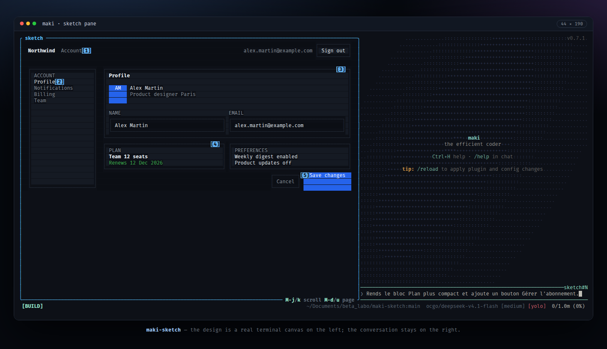
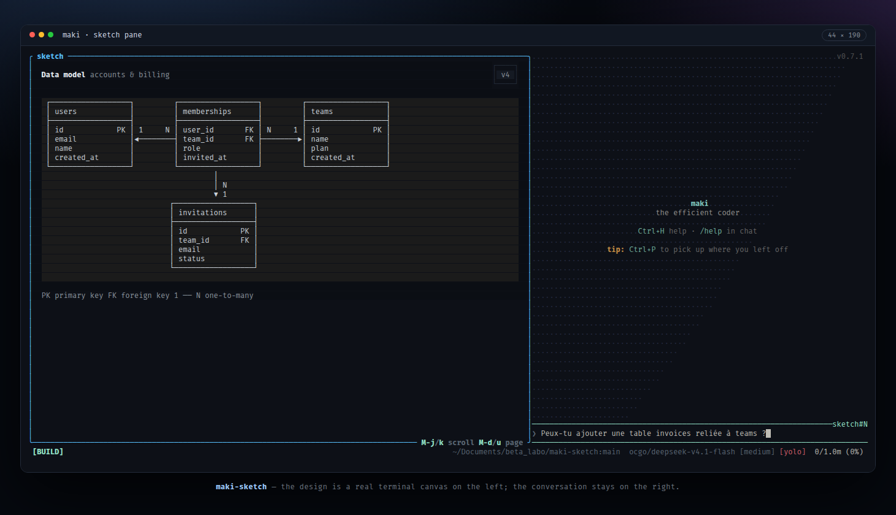

# maki-sketch

A terminal design canvas for [maki](https://maki.sh). The agent writes HTML/CSS,
the canvas renders it in a pane docked on the left, and the chat stays on the
right. Tag elements with `data-point` and a click writes `#N` into the prompt,
so you can answer `#2 make this button smaller` without describing it.





The renderer is a small HTML/CSS engine painted into the terminal cell grid, so
it draws interfaces and diagrams alike: wireframes, flow diagrams, schema
sketches.

## Install

Hand install (development):

```bash
git clone https://github.com/Anhydrite/maki-sketch ~/maki-sketch
mkdir -p ~/.local/share/maki/site/pack/dev/start
ln -s ~/maki-sketch ~/.local/share/maki/site/pack/dev/start/maki-sketch
```

Restart maki once. Or manage it from `~/.config/maki/init.lua`:

```lua
maki.pack.add({
  { src = "https://github.com/Anhydrite/maki-sketch", version = "main" },
})
```

## Use

The agent draws with the `sketch_render` tool when you ask for a screen, a
wireframe or a diagram.

```
/sketch                 open the pane
/sketch close           close it
/sketch width 70%       resize it
/sketch scroll 42       jump to line 42
/sketch export          write the HTML
```

While the pane is open: `M-j`/`M-k` scroll one line, `M-d`/`M-u` half a page,
`M-g`/`M-G` top and bottom.

## Notes

- Practical CSS subset: block, inline, flex, absolute positioning, borders,
  colours, custom properties, `white-space: pre`.
- Short designs hug their content; taller ones scroll instead of being clipped.
- Designs are saved in `.sketch/` in the working directory.

## License

MIT © 2026 Anhydrite
